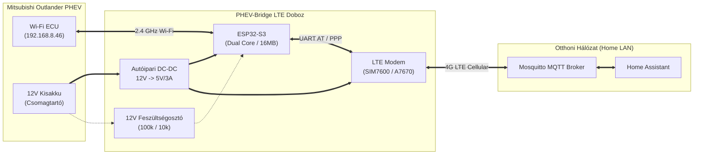

# PHEV-Bridge LTE (ESP32-S3) — Teljes Összeszerelési és Gyártási Útmutató (Assembly Guide)

> **Verzió:** 1.0.0  
> **Céljármű:** Mitsubishi Outlander PHEV (2013–2024) / Eclipse Cross PHEV  
> **Cél:** LTE kapcsolaton át MQTT-hez csatlakozó hardvermodul építése, amely az autó Wi-Fi-jén keresztül kommunikál a járművel.

---

## Tartalomjegyzék
1. [A rendszer működési elve](#1-a-rendszer-működési-elve)
2. [Anyagjegyzék (Bill of Materials - BOM)](#2-anyagjegyzék-bill-of-materials---bom)
3. [Autóipari tápellátás és védelmi áramkör](#3-autóipari-tápellátás-és-védelmi-áramkör)
4. [Hardver bekötési rajz és kapcsolás](#4-hardver-bekötési-rajz-és-kapcsolás)
5. [Összeszerelés lépésről lépésre (Step-by-Step)](#5-összeszerelés-lépésről-lépésre-step-by-step)
6. [Beszerelés az Outlander PHEV-be](#6-beszerelés-az-outlander-phev-be)
7. [Szoftveres felprogramozás (Provisioning)](#7-szoftveres-felprogramozás-provisioning)
8. [Üzembe helyezési és minőségellenőrzési lista (QA Checklist)](#8-üzembe-helyezési-és-minőségellenőrzési-lista-qa-checklist)
9. [Hibaelhárítási útmutató (Troubleshooting)](#9-hibaelhárítási-útmutató-troubleshooting)

---

## 1. A rendszer működési elve

Az Outlander PHEV gyári távvezérlése kizárólag a gépkocsi saját 2.4 GHz-es Wi-Fi Access Pointján (`REMOTExxxxxx`) keresztül működik, legfeljebb 10–20 méteres hatótávolságban.

A **PHEV-Bridge LTE** egy dobozolt, gépjárműbe rejtett átjáró, amely:
1. **Belső Wi-Fi rádión** folyamatosan az autó Wi-Fi AP-jára csatlakozik (`192.168.8.46:8080`).
2. **4G LTE modemen** keresztül mobilinternetet biztosít.
3. **SIM-kártyás LTE kapcsolaton** keresztül közvetlenül csatlakozik az MQTT brokerhez.
4. **Kétirányú MQTT átjáróként** publikálja az akkumulátor, hűtés/fűtés, ajtó- és töltésadatokat a Home Assistant felé, valamint fogadja a vezérlőparancsokat.
5. **Védi a 12V-os segédakkumulátort**: méri a feszültséget, és ha a jármű 3-4 napig nincs töltőn, automatikusan ultra-alacsony fogyasztású alvó módba (Duty-Cycle Deep Sleep, < 3 mA) kapcsol.



---

## 2. Anyagjegyzék (Bill of Materials - BOM)

Két megvalósítási út lehetséges:
- **"A" Opció (Ajánlott "All-in-One"):** Gyárilag integrált ESP32-S3 + LTE lapka (pl. **LilyGO T-SIM7600E-H** vagy **LilyGO T-A7670E**). Kevesebb forrasztás, kompakt méret, gyári SIM foglalat.
- **"B" Opció (Moduláris diszkrét):** Különálló ESP32-S3 DevKit + különálló SIMCOM LTE modul. Olcsóbb, könnyen cserélhető komponensek.

### 2.1. Fő komponensek (BOM Lista)

| Tétel | Mennyiség | Megnevezés / Típus | Ajánlott forrás / Cikkszám | Becsült ár | Megjegyzés |
|---|---|---|---|---|---|
| **1** | 1 db | **All-in-One Integrált Lapka** | **LilyGO T-A7670E R2 With GPS [Q334]** | ~14 000 Ft | **A kiválasztott hardver!** Tartalmazza az ESP32-t, LTE modemet, GPS vevőt, SIM foglalatot, 4G és GPS antennát! |
| **2** | 1 db | **Tápellátás opció 1: Power Bank / LiPo** | 10.000 mAh Pass-Through Power Bank vagy 3.7V LiPo akku | ~4 500 - 8 000 Ft | **Ajánlott:** 100% függetlenség a kisakkutól, szivargyújtóról öntöltődő |
| **[Alt 2]**| 1 db | **Tápellátás opció 2: Autó 12V bekötés** | MP1584EN DC-DC (5V 3A) + 2A Fuse Tap + Védelmi áramkör | ~2 500 Ft | Ha állandó 12V-os autóipari bekötést szeretnél |
| **3** | 1 db | **Autós Szivargyújtós USB Töltőfej** | Baseus / Ugreen 12V -> USB-C 30W mini töltőfej | ~2 500 Ft | A csomagtartó szivargyújtójába dugva tölti a power bankot menet közben |
| **4** | 1 db | **Nano-SIM Kártya** | Telekom, Yettel, Vodafone vagy 1Komma5 IoT SIM | ~500–1000 Ft/hó | Havi 50–100 MB adatforgalom bőven elég |
| **5** | 1 db | **Műszerdoboz (Enclosure)** | ABS univerzális doboz vagy 3D nyomtatott PETG ház | ~1 500 Ft | **NE PLA-ból nyomtasd!** Autóban nyáron 65°C is lehet! |

---

## 3. Autóipari tápellátás és védelmi áramkör

A gépjárművek 12V-os elektromos rendszere **nem tiszta 12V DC**:
- Nyugalomban: $12.4\text{V} - 12.8\text{V}$
- Menet közben / nagyfeszültségű akkuról töltve: $14.1\text{V} - 14.7\text{V}$
- Relék, mágnesszelepek kapcsolásakor induktív feszültségtüskék keletkezhetnek (akár $+40\text{V}$ - $+60\text{V}$ *load dump* tranziensek).

Ezért az áramkört megfelelő védelemmel kell ellátni:

```text
12V In (+) o──[ 2A Biztosíték ]──[ SS34 Dióda ]──┬──────────────────────┬──o DC-DC IN (+)
                                                 │                      │
                                            [ SMAJ15A TVS ]        [ 100k R1 ]
                                                 │                      │
                                                 │                      ├──o ADC (GPIO 1)
                                                 │                      │
                                                 │                 [ 10k R2 ] // [ 100nF C1 ]
                                                 │                      │
GND (-)    o─────────────────────────────────────┴──────────────────────┴──o DC-DC IN (-) & GND
```

### Az elemek szerepe:
1. **2A Lengő- / Panelbiztosíték:** Rövidzárlat esetén azonnal lekapcsol, megvédi az autó kábelkorbácsát.
2. **SS34 Schottky Dióda:** Meggátolja a fordított bekötésből adódó azonnali tönkremenetelt.
3. **SMAJ15A TVS Dióda:** Minden 15-18V feletti tranzienst azonnal a testre vezet.
4. **100k / 10k Feszültségosztó ($11:1$):**
   $$V_{\text{out}} = V_{\text{in}} \times \frac{10\,\text{k}\Omega}{100\,\text{k}\Omega + 10\,\text{k}\Omega} = \frac{V_{\text{in}}}{11}$$
   - $12.6\text{V}$ akkunál: $1.145\text{V}$ jut a GPIO 1 lábra.
   - $14.5\text{V}$ töltésnél: $1.318\text{V}$ jut a GPIO 1 lábra.
   - Bőségesen az ESP32-S3 ADC 0–3.1V biztonságos tartományán belül marad!
5. **100nF Szűrőkondenzátor:** Kiszűri a kapcsolóüzemű zajokat és a generátorhullámzást, stabil mérési eredményt nyújtva.

---

## 4. Hardver bekötési rajz és kapcsolás

### 4.1. LilyGO T-A7670E R2 Integrált Hardver

Mivel a kiválasztott **LilyGO T-A7670E R2** egy All-in-One lapka, **nem kell vezetékeket forrasztanod az ESP32 és a modem közé**, a NYÁK-on gyárilag össze vannak kötve az alábbi belső lábkiosztással:

| Belső Funkció | ESP32 GPIO | A7670E Modem Láb | Megjegyzés |
|---|---|---|---|
| **Modem TXD (ESP RX)** | `GPIO 26` | A7670E TXD | Hardveres UART1 vételi vonal |
| **Modem RXD (ESP TX)** | `GPIO 27` | A7670E RXD | Hardveres UART1 adási vonal |
| **Modem PWRKEY** | `GPIO 4` | PWRKEY | Bekapcsoló impulzus (1 mp HIGH) |
| **Modem RESET** | `GPIO 5` | RESET | Hardveres újraindítás |
| **Modem DTR (Sleep)** | `GPIO 25` | DTR | Alvó mód vezérlés (HIGH = alvás, LOW = ébrenlét) |
| **Tápfeszültség engedélyezés**| `GPIO 12` | VDD_EXT / EN | A szoftver automatikusan HIGH-ra állítja a perifériák táplálásához |
| **Akkumulátor ADC mérő** | `GPIO 35` | Li-ion VBat | Beépített feszültségosztó az akku figyeléséhez |

### 4.2. Külső Csatlakozók és Antennák:
1. **LTE Antenna:** Csatlakoztasd a készletben lévő 4G LTE botantennát a kártya **`LTE` (vagy MAIN)** jelölésű SMA csatlakozójára.
2. **GPS Antenna:** Csatlakoztasd a készletben lévő aktív GPS vevőantennát a kártya **`GPS`** jelölésű IPEX/SMA aljzatára. Az antenna mágneses vagy ragasztható felét a szélvédő/műanyag felület alá érdemes elhelyezni, felfelé nézve.
3. **Nano-SIM kártya:** Helyezd be a PIN-kód nélküli Nano-SIM kártyát a foglalatba.
4. **Tápellátás:**
   - **Opció A (Ajánlott):** Power bank vagy 12V szivargyújtós USB töltő az **USB-C** portba.
   - **Opció B:** 3.7V-os LiPo akkumulátor közvetlenül a lapka fehér **JST-PH 2.0mm** akkumulátorcsatlakozójára.

---

## 4.3. GPS Nyomkövetés és Home Assistant Térkép Integráció

A modul a beépített A7670E GNSS motornak köszönhetően folyamatosan méri az autó földrajzi koordinátáit, és automatikusan regisztrálja a Home Assistantban a **`device_tracker`** entitást:

### Mit látsz a Home Assistantban?
1. **Jármű pozíció a Térképen:**  
   A Home Assistant beépített Térkép (Map) nézetében megjelenik az autó egyedi autóikonnal (`mdi:car-connected`).
2. **Zóna-érzékelés:**  
   Automatikusan érzékeli, ha az autó belép vagy kilép a beállított zónákból:
   - `Otthon` (Home)
   - `Munkahely` (Work)
   - `Töltőállomás` (Charging Zone)
3. **Valós idejű telemetria szenzorok:**
   - `sensor.phev_location_latitude` (Szélesség)
   - `sensor.phev_location_longitude` (Hosszúság)
   - `sensor.phev_location_speed` (Sebesség km/h-ban)
   - `sensor.phev_location_satellites` (Látott GPS műholdak száma)

### Példa automatizmus Home Assistantban:
> **Példa:** *"Ha a gépkocsi elhagyja az 'Otthon' zónát és az ajtók nincsenek bezárva, küldjön figyelmeztető push értesítést a telefonra!"* vagy *"Ha hazaérkezel télen, automatikusan kapcsolja fel a garázsvilágítást."*

---

## 5. Összeszerelés lépésről lépésre (Step-by-Step)

### 1. Lépés: A feszültségosztó és a táp előkészítése
1. Egy kisméretű próbapanelen (protoboard, 30x50 mm) forraszd össze a feszültségosztót:
   - Forraszd be a $100\ \text{k}\Omega$-os ellenállást a 12V bemenet és a mérőpont közé.
   - Forraszd be a $10\ \text{k}\Omega$-os ellenállást és a $100\ \text{nF}$-os kerámia kondenzátort párhuzamosan a mérőpont és a közös GND közé.
   - Vezess ki egy vezetéket a mérőpontról az ESP32-S3 `GPIO 1` lábára.
2. Állítsd be a DC-DC konverter kimeneti feszültségét:
   - Ha trimmeres LM2596-ot vagy MP1584-et használsz, **mielőtt az ESP32-re kötnéd**, labortápról / 12V-os akkuról adj neki tápot, és egy multiméterrel mérve állítsd be a kimenetet pontosan **$5.05\text{V} - 5.15\text{V}$** közé!
   - Rögzítsd a trimmerkondit egy csepp melegenyvvel vagy lakkal, hogy az autó rezgésétől ne állítódhasson el!

### 2. Lépés: A vezetékezés elkészítése
1. Kösse össze az ESP32-S3 és az LTE modul UART kommunikációs vonalait:
   - `ESP GPIO 17 (TX)` $\rightarrow$ `Modem RXD`
   - `ESP GPIO 18 (RX)` $\rightarrow$ `Modem TXD`
   - `ESP GND` $\rightarrow$ `Modem GND`
2. Kösse össze a vezérlő vonalakat:
   - `GPIO 4` $\rightarrow$ `Modem PWRKEY`
   - `GPIO 5` $\rightarrow$ `Modem RESET`
   - `GPIO 6` $\rightarrow$ `Modem DTR` (ez végzi a modem mélyalvásba küldését és felébresztését)
   - `GPIO 7` $\rightarrow$ `Modem STATUS`
3. Kösse össze a tápellátást:
   - A DC-DC konverter 5V kimenetét kösd az ESP32-S3 `5V / VBUS` lábára és a Modem `5V / VCC` lábára.
   - A GND vonalakat forraszd közös csillagpontba!

### 3. Lépés: Antennák és SIM kártya behelyezése
1. Helyezd be az aktív, PIN-kód mentes nanoSIM / microSIM kártyát a foglalatba.  
   *(Ellenőrizd előre telefonban, hogy a SIM kártya PIN kérése ki legyen kapcsolva!)*
2. Csatlakoztasd az LTE antennát a modem `MAIN` (vagy `LTE`) SMA/U.FL csatlakozójára.
3. Csatlakoztasd a Wi-Fi antennát az ESP32-S3 antennacsatlakozójára (ha külső antennás verzió).

### 4. Lépés: Beépítés a műszerdobozba
1. Rögzítsd a kártyákat műanyag (Nylon) M2.5 távtartókkal a doboz alsó feléhez.
2. Vezesd ki a tápkábelt a doboz oldalán egy gumitömítésen (kábelátvezetőn) keresztül.
3. Készíts egy USB-C nyílást a dobozon, hogy szükség esetén a kábelt közvetlenül rá tudd dugni anélkül, hogy szét kellene csavarozni a dobozt.
4. Ragaszd be az LTE antennát a doboz tetejére (belülről vagy kívülről, fém felülettől legalább 2-3 cm távolságra).

---

## 6. Beszerelés az Outlander PHEV-be

### Miért a csomagtartó jobb oldala a tökéletes beépítési hely?
A Mitsubishi Outlander PHEV-ben:
1. **A 12V-os segédakkumulátor a csomagtartó padlólemeze alatt, a jobb oldali rekeszben található!**
2. **A gyári Wi-Fi vezérlő ECU (EV Remote ECU) a hátsó üléssor mögött, a padlólemezen található!**

Ezért **NEM kell vezetékeket behúzni a műszerfalig**: a csomagtartó jobb oldali burkolata mögött minden adott:
- Maximális Wi-Fi térerő (a modul mindössze 50–80 cm-re lesz a gyári Wi-Fi antennától).
- Közvetlen, 12V-os tápellátási pont.
- Láthatatlan elhelyezés: a kárpit mögött vagy a jobb oldali rekeszben a doboz teljesen elrejthető.

### Bekötés az autó 12V-os hálózatára:
1. **Biztosíték leágazás:**
   - A csomagtartó jobb oldalában található a hátsó kiegészítő biztosítéktábla vagy a 12V-os szivargyújtó aljzat kábelkorbácsa.
   - A legtisztább megoldás a **Fuse Tap (rablóbiztosíték)** használata egy állandó 12V-os (BATT / +30) pozícióban egy 2A-es biztosítékkal.
   - Alternatívaként a 12V-os akkumulátor pozitív sarujának kiegészítő elosztójára köthető egy lengőbiztosítékházon keresztül.
2. **Test (GND) bekötése:**
   - A jobb oldali kerékdob belső felületén gyári M6-os testpont (földelőcsavar) található. Használj szemes sarut!
3. **Antenna elhelyezése:**
   - Az LTE antennát ragaszd a hátsó oldalablak műanyag kárpitja mögé (ne fémre!). Az üvegen és műanyagon a 4G jelek akadálytalanul átjutnak.

---

## 7. Szoftveres felprogramozás és párosítás

1. Tegyél a modembe aktív, mobilinternetre képes SIM-kártyát; a SIM PIN-kérés legyen kikapcsolva.
2. Töltsd fel a firmware-t USB-n keresztül az alábbi PlatformIO parancsokkal.
3. Első induláskor csatlakozz a `PHEV-Bridge-Setup` Wi-Fi hotspothoz, és nyisd meg a `http://192.168.4.1` címet.
4. Add meg a 17 karakteres VIN-t és az admin felületen létrehozott pairing code-ot. A backend járműrekordjában már szerepelnie kell az autó Wi-Fi SSID-jének és jelszavának.
5. A telefon mobiladat-kapcsolatán keresztül a portál lekéri az autó Wi-Fi és MQTT hitelesítési adatait, majd elmenti az ESP32-be.

Állítsd a backend `.env` fájljában a `PUBLIC_MQTT_URL` értékét erre: `wss://mqtt.lorinszkym.synology.me:443/mqtt`, majd indítsd újra a backendet. A Synology reverse proxy a HTTPS 443-as forgalmat a `localhost:8083` HTTP WebSocket listenerre továbbítsa, az `/mqtt` útvonalat és a WebSocket upgrade-et engedélyezve. Ha a jármű rekordjának saját `mqtt_broker_url` értéke van, azt is frissítsd erre az URL-re. Párosítsd újra az ESP32-t, hogy letöltse az új beállítást.

### 2. Fordítás és feltöltés USB-n keresztül
Csatlakoztasd az ESP32-S3 USB-C portját a számítógépedhez:

```bash
cd /Volumes/work/work/private/phev2mqtt/esp32-s3

# Fordítás ellenőrzése
pio run

# Feltöltés a mikrokontrollerre
pio run -t upload

# Soros monitor megnyitása (115200 baud)
pio device monitor
```

---

## 8. Üzembe helyezési és minőségellenőrzési lista (QA Checklist)

Mielőtt véglegesen lezárnád a dobozt és beépítenéd az autóba, végezd el az alábbi 6 pontos ellenőrzést:

- [ ] **1. Tápfeszültség és 12V mérés:**
  A soros monitoron ellenőrizd az indulási üzenetet:
  ```text
  [PWR] Power Manager initialized. 12V Battery Voltage: 12.64 V
  ```
  Ha az érték eltér a multiméteres méréstől, a `config.h`-ban lévő `BATTERY_12V_DIVIDER_RATIO` szorzót finomhangold!
- [ ] **2. LTE Mobilnet kapcsolat:**
  ```text
  [LTE] Modem Info: SIMCOM_SIM7600E, IMEI: 86...
  [LTE] Cellular network registered successfully!
  [LTE] Operator: Telekom HU, CSQ: 24 (RSSI: -65 dBm)
  [LTE] LTE Connected! Cellular IP: 10.xx.xx.xx
  ```
- [ ] **3. Autó Wi-Fi kapcsolat és Rolling XOR kézfogás:**
  Állj az autó közelébe, kapcsold be a modult:
  ```text
  [PHEV] Wi-Fi connected to REMOTE12a34b (RSSI: -48 dBm)
  [PHEV] Car TCP connected successfully!
  [PHEV] Received security handshake request 0x5e, initializing rolling XOR
  [PHEV] Car VIN: JMBXDGG2W...
  [PHEV] Battery: 100% (raw 94%, maxSoc 94%), ParkingLights: OFF
  ```
- [ ] **4. Home Assistant Auto-Discovery:**
  Nyisd meg a Home Assistantot $\rightarrow$ Beállítások $\rightarrow$ Eszközök és szolgáltatások $\rightarrow$ MQTT.  
  Meg kell jelennie a **Mitsubishi Outlander PHEV** eszköznek az összes szenzorral és kapcsolóval (Akkumulátor %, Fűtés/Hűtés kapcsoló, Ajtók, 12V akku feszültség).
- [ ] **5. MQTT kapcsolat:** ellenőrizd a backend naplóiban és a brokerben, hogy az eszköz a VIN-hez tartozó device ID-val csatlakozik.

---

## 9. Hibaelhárítási útmutató (Troubleshooting)

| Hibajelenség | Lehetséges ok | Megoldás |
|---|---|---|
| **Nem indul el az ESP32, villog vagy újraindul** | Tápellátási áramkorlát | Az LTE modem hálózatra csatlakozáskor csúcsban akár 1.5–2A áramot is felvehet. Győződj meg róla, hogy a DC-DC konverter legalább 3A terhelhetőségű! Tegyél egy 470µF – 1000µF elektrolit kondenzátort az 5V és a GND közé. |
| **A modem nem lát hálózatot (`waitForNetwork` timeout)** | Nincs térerő vagy hibás antenna / PIN kód | Ellenőrizd, hogy a SIM kártya PIN kérése ki van-e kapcsolva telefonban. Győződj meg róla, hogy az antenna az `LTE MAIN` csatlakozóra van tekerve, nem a `GNSS / GPS` aljzatra. |
| **Wi-Fi nem kapcsolódik az autóhoz (`WL_DISCONNECTED`)** | Túl sok regisztrált telefon az autóban | Az Outlander Wi-Fi modulja egyszerre maximum **2 regisztrált eszközt (MAC címet)** engedélyez. Ha már két telefon regisztrálva van, az autó gyári menüjében (vagy a távirányító gombjának 10-szeri megnyomásával) törölni kell a korábbi párosításokat! |
| **A Home Assistantban az akku 5%-ra ugrik** | Régi kódhiba | Ellenőrizd a `phev_client.cpp`-ben a `processBatteryGlitchFilter` meglétét: a modul automatikusan kiszűri a felébredéskor érkező téves 5%-os értékeket. |
| **Az eszköz nem csatlakozik az MQTT brokerhez** | WSS URL, reverse proxy WebSocket beállítás, LTE időszinkron vagy eszköz-hitelesítés | Ellenőrizd a `wss://...:443/mqtt` URL-t, a 443 → `localhost:8083` proxy útvonalat, a proxy WebSocket támogatását és a soros napló TLS/MQTT hibáit; szükség esetén párosítsd újra a VIN-nel és pairing code-dal. |
| **12V alacsony feszültség riasztás (< 11.9V)** | Rosszul kalibrált feszültségosztó | Mérd meg multiméterrel a valós feszültséget az akkumulátoron. A `config.h`-ban lévő `BATTERY_12V_DIVIDER_RATIO` értéket állítsd arányosan, amíg a szoftver által kiírt érték pontosan meg nem egyezik a multiméterrel. |

---

## 10. Összegzés és "Out-of-the-Box" Dobozolás

A fentiek alapján megépített hardver egy teljesen autonóm, zárt, megbízható rendszer:
- Nincs szükség telefonra a közelben.
- Nincs hatótávkorlát: az autó a világ bármely pontjáról elérhető és fűthető/hűthető mobilneten keresztül.
- Nem meríti le a 12V-os akkumulátort még hetekig tartó repülőtéri parkolás alatt sem.
- A firmware az otthoni fotelből, egyetlen paranccsal (`ota http://...`) frissíthető.
