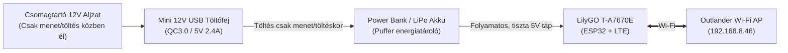

# PHEV-Bridge — Power Bank Tápellátású Összeszerelési és Üzemidő Útmutató

> **Cél:** A gépjármű 12V-os segédakkumulátorának **teljes fizikai és galvanikus függetlenítése** külső akkumulátor (Power Bank vagy dedikált Li-ion akkumulátor) használatával.  
> **Előny:** 0% esély arra, hogy a modul lemeríti a jármű 12V-os akkumulátorát, nem kell megbontani a biztosítéktáblát, nem kell vezetékezni az autóban — valódi 100% Plug-and-Play megoldás!

---

## 1. Üzemidő Számítás: Meddig bírja egy 10.000 mAh-s Power Bank?

### 1.1. A valós kivehető energia kiszámítása
Egy 10.000 mAh-s power bank belső lítium-ion cellái névlegesen **$3.7\text{ V}$** feszültségűek:
$$\text{Összes energiakapacitás} = 10\,000\text{ mAh} \times 3.7\text{ V} = 37.0\text{ Wh}$$

A power bank belső Step-Up (feszültségnövelő) áramköre az 5V-os USB kimenetre alakítja át ezt az energiát, tipikusan **$\approx 85\%$-os hatásfokkal**:
$$\text{Valós kivehető energia} = 37.0\text{ Wh} \times 0.85 = \mathbf{31.45\text{ Wh}}$$

Ez 5V-os kimeneten mérve a ténylegesen kivehető milliamperórában:
$$\text{Valós kivehető kapacitás (5V-on)} = \frac{31.45\text{ Wh}}{5.0\text{ V}} = \mathbf{6290\text{ mAh}}$$

---

### 1.2. Fogyasztási profilok és újratöltési idők

A modul áramfelvétele attól függ, hogy milyen üzemmódban futtatjuk a firmware-t:

| Üzemmód | Működési leírás | Átlagos áramfelvétel (5V-on) | 10.000 mAh Power Bank Üzemidő | Mennyi időnként kell tölteni? |
|---|---|---|---|---|
| **1. Folyamatos Aktív Mód** | 24/7 folyamatos Wi-Fi + LTE kapcsolat, 15 mp-es MQTT frissítés | $\approx 120\text{ mA}$ ($0.6\text{ W}$) | $\frac{6290\text{ mAh}}{120\text{ mA}} \approx \mathbf{52.4\text{ óra}}$ | **$\approx 2.2\text{ naponta}$** |
| **2. Optimalizált Csatlakozott Mód** | DTIM Wi-Fi energiatakarékos vétel + 80MHz CPU órajel | $\approx 55\text{ mA}$ ($0.27\text{ W}$) | $\frac{6290\text{ mAh}}{55\text{ mA}} \approx \mathbf{114.3\text{ óra}}$ | **$\approx 4.8\text{ naponta}$** |
| **3. Periodikus Alvó Mód (15 perc)** | 14 perc Deep Sleep (<2mA), 1 perc ébrenlét (szinkron és parancsellenőrzés) | $\approx 8.5\text{ mA}$ ($0.04\text{ W}$) | $\frac{6290\text{ mAh}}{8.5\text{ mA}} \approx \mathbf{740\text{ óra}}$ | **$\approx 31\text{ naponta}$ (1 hónap!)** |
| **4. Periodikus Alvó Mód (30 perc)** | 29 perc Deep Sleep (<2mA), 1 perc ébrenlét | $\approx 5.2\text{ mA}$ ($0.026\text{ W}$) | $\frac{6290\text{ mAh}}{5.2\text{ mA}} \approx \mathbf{1209\text{ óra}}$ | **$\approx 50\text{ naponta}$ (~1.7 hónap!)** |
| **5. Öntöltő Puffer Mód (UPS)** *(Ajánlott!)* | Szivargyújtóra dugva: töltődik menet közben és az autó töltésekor | $\text{Autonóm}$ | $\mathbf{\infty\text{ (Végtelen)}}$ | **Soha nem kell kiszerelni!** |

---

## 2. A "Power Bank Auto-Shutoff" csapda és a megoldás

> [!WARNING]
> **A legtöbb kereskedelmi forgalomban kapható power bank 30–60 másodperc után automatikusan KIKAPCSOL, ha a fogyasztás 50–100 mA alá esik!**  
> Ha az ESP32 mélyalvásba (Deep Sleep) megy, ahol a fogyasztás mindössze pár milliamper, a sima power bank "azt hiszi", hogy lehúzták róla a telefont, és lekapcsolja az 5V-os kimenetet. Ekkor az ESP32 soha többé nem ébredne fel!

### A 3 bevált megoldás az Auto-Shutoff elkerülésére:

#### 1. Megoldás: "Kisáramú / Always-On" funkcióval rendelkező Power Bank
Sok minőségi power bank rendelkezik úgynevezett **"Trickle Charge" (kisáramú / fülhallgató töltő) móddal** vagy **Always-On** funkcióval, ami tiltja az automatikus lekapcsolást:
- **Xiaomi Mi Power Bank 3 / Redmi Power Bank:** a bekapcsológombot **kétszer gyorsan megnyomva** 2 órás kisáramú módba lép, vagy folyamatosan bekapcsolva marad.
- **Anker PowerCore:** a gomb hosszan nyomásával zöld LED jelzi a kisáramú módot.
- **Voltaic Systems V25 / V50:** kifejezetten IoT és mikrokontrolleres célra tervezett, garantáltan soha le nem kapcsoló (Always-On) ipari power bank.

#### 2. Megoldás: Közvetlen Lítium akkumulátor a LilyGO lapka saját akkutöltőjére *(A legtisztább!)*
A **LilyGO T-A7670E** lapkán **gyárilag rajta van a komplett lítium akkumulátortöltő és feszültségszabályzó áramkör** egy szabványos 2-pines **JST-PH 2.0mm** csatlakozóval!
- Ha nem külső USB power bankot használsz, hanem egy **3.7V-os 10.000 mAh LiPo lapos akkumulátort** vagy egy **párhuzamos 18650 akkutartót** dugsz be közvetlenül a LilyGO lapka JST csatlakozójába:
  - **NINCS semmilyen lekapcsolási probléma!**
  - Nincs szükség 5V-os Step-Up konverterre, a lapka közvetlenül 3.7V-ról táplálkozik 95%-os hatásfokkal.
  - Az akkumulátort a lapka a saját USB-C portján keresztül tudja tölteni, miközben folyamatosan működik!

---

## 3. Az "Öntöltő Puffer / UPS" Rendszer (A Legokosabb Megoldás)

Nem kell a power bankot hetente vagy havonta kézben felvinni a lakásba tölteni, ha az autó maga automatikusan újratölti!

### Hogyan működik az Outlander PHEV-ben?
Az Outlander PHEV-ben a csomagtartó jobb oldalán lévő 12V-os szivargyújtó aljzat (vagy a gyári USB portok):
- **Automatikusan BEKAPCSOL**, valahányszor a járművet bekapcsolod (Ready / ACC mód),
- és **Automatikusan BEKAPCSOL**, valahányszor a gépkocsit az utcai vagy otthoni EV töltőre dugod (mert a fedélzeti DC-DC konverter ilyenkor aktív és tölti a rendszert)!

### Ennek a felépítésnek az óriási előnyei:
1. **100% függetlenség a kisakkutól:** Amikor az autó áll és parkol, a szivargyújtó aljzat áramtalanítva van. A modul kizárólag a power bank energiáját fogyasztja.
2. **Nulla vezetékelés:** Csak bedugsz egy USB autós töltőt a csomagtartó szivargyújtójába, rákötöd a power bankot, a power bankból pedig egy USB kábelt a LilyGO lapkába.
3. **Örök üzemidő:** Bármikor mész a kocsival 30–60 percet, vagy felteszed a garázsban a töltőre 3 órára, a power bank teljesen visszatöltődik!

---

## 4. Anyagjegyzék a Power Bankos Kiépítéshez (BOM)

A power bankos megoldással az alkatrészlista lényegesen leegyszerűsödik: nem kell biztosíték-rabló (Fuse Tap), nem kell DC-DC konverter, nem kellenek ellenállások:

| Tétel | Mennyiség | Komponens | Ajánlott típus | Becsült ár |
|---|---|---|---|---|
| **1** | 1 db | **Integrált ESP32 + LTE modul** | LilyGO T-A7670E R2 With GPS [Q334] | ~14 000 Ft |
| **2** | 1 db | **Power Bank (Pass-Through képes)** | Anker PowerCore 10.000 vagy Baseus 10.000mAh | ~7 000 - 9 000 Ft |
| **[Alt 2]**| 1 db | **Közvetlen LiPo Akkumulátor** | 3.7V 5000–10000 mAh LiPo akku JST-PH 2.0 csatlakozóval | ~4 500 - 6 500 Ft |
| **3** | 1 db | **Autós Szivargyújtós USB Töltőfej** | Baseus vagy Ugreen 12V $\rightarrow$ USB-C 30W mini töltőfej | ~2 500 Ft |
| **4** | 2 db | **Rövid USB kábel** | 30 cm-es USB-A $\rightarrow$ USB-C és USB-C $\rightarrow$ USB-C kábel | ~1 000 Ft |
| **5** | 1 db | **SIM kártya** | Telekom, Yettel, Vodafone vagy 1Komma5 IoT SIM | ~500–1000 Ft/hó |
| **6** | 1 db | **Doboz / Rögzítés** | Műanyag doboz vagy neoprén tok + öntapadós tépőzár | ~1 000 Ft |
| **7 (Opcionális)**| 1 db | **OBD2 Bluetooth Adapter (PHEV Watchdog)** | vGate iCar Pro Bluetooth (v3.0/v4.0) vagy olcsó ELM327 BT | ~4 000 - 10 000 Ft |

---

## 5. Beépítés lépésről lépésre

1. **SIM kártya és Antennák csatlakoztatása:**
   - Helyezd be a PIN-kód mentes Nano-SIM kártyát a LilyGO kártya hátulján lévő foglalatba.
   - Csavard fel a mellékelt 4G LTE botantennát az **`LTE`** SMA csatlakozóra.
   - Csatlakoztasd a mellékelt aktív GPS antennát a **`GPS`** csatlakozóra (a mágneses/ragasztható antennát a hátsó oldalablak műanyag burkolata alá helyezd, hogy rálásson az égre).
2. **Elhelyezés a járműben:**
   - Nyisd ki az Outlander PHEV csomagtartóját.
   - A jobb oldali kárpitban található a gyári **12V-os szivargyújtó aljzat**.
   - Dugd be az USB-s autós töltőfejet az aljzatba.
3. **Csatlakoztatás:**
   - Kösd össze az autós töltőt a power bank töltőbemenetével.
   - Kösd össze a power bank 5V-os kimenetét a LilyGO T-A7670E USB-C portjával.
4. **OBD2 Adapter Csatlakoztatása (Opcionális, ha szeretnél mélydiagnosztikát):**
   - Az Outlander PHEV OBD2 csatlakozója a **vezetőoldali lábtérben, a pedálok felett balra** található.
   - Egyszerűen dugd be a Bluetooth-os **vGate iCar Pro** adaptert.
   - Az adapter automatikusan elalszik, ha az autó nem üzemel, így nem meríti az akkut.
   - Az ESP32 Bluetooth-on automatikusan felcsatlakozik rá a kabinon keresztül!
5. **Kész!**
   - Helyezd el a power bankot és a modult a jobb oldali rekeszbe vagy hálós tárolóba.
   - A rendszer automatikusan felcsatlakozik az autó Wi-Fi-jére, a mobilnetre és az OBD2 olvasóra.

---

## 6. Home Assistant Entitások & PHEV Watchdog Adatok

A firmware automatikusan felregisztrálja a Home Assistantba a következő mélydiagnosztikai entitásokat:

| Entitás | Típus | Leírás |
|---|---|---|
| `sensor.phev_battery_soh` | Diagnosztika (%) | **Valós State of Health (SOH)** – az akku tényleges állapota (pl. 84.2%) |
| `sensor.phev_battery_capacity_ah` | Diagnosztika (Ah) | Tényleges BMU akkukapacitás (pl. 32.1 Ah a gyári 38 Ah helyett) |
| `sensor.phev_cell_min_mv` | Szenzor (mV) | A 80 cella közül a **leggyengébb cella pillanatnyi feszültsége** |
| `sensor.phev_cell_max_mv` | Szenzor (mV) | A **legerősebb cella feszültsége** |
| `sensor.phev_cell_delta_mv` | Szenzor (mV) | **Cella eltérés / balansz** (`max - min`): ha >30mV, a cellák kiegyensúlyozásra szorulnak! |
| `sensor.phev_battery_temp_min / max`| Hőmérséklet (°C) | Akkupakk modul hőmérséklet szélsőértékek |
| `sensor.phev_pack_voltage / current`| Villamos (V, A, kW) | Nagyfeszültségű hajtóakku feszültség, áram (+ kisütés, - töltés) és pillanatnyi kW |
| `sensor.phev_fuel_liters` | Szenzor (L) | Benzin üzemanyagszint literben (0–45 L) |
| `sensor.phev_coolant_temp` | Hőmérséklet (°C) | Benzinmotor hűtővíz hőfok |
| `sensor.phev_odometer` | Számláló (km) | Valós kilométeróra állás |
| `device_tracker.phev_location` | GPS Térkép | Valós idejű gépjármű pozíció, sebesség, műholdak száma |

---

## 7. Webes Beállítás és Captive Portal (Out-of-the-Box Üzembehelyezés)

A modul rendelkezik egy beépített **Webes Setup Varázslóval (Captive Portal)**, így a konfigurációhoz **nem kell módosítani a forráskódot**:

1. **Első bekapcsoláskor (vagy ha a modul még nincs beállítva):**
   - A LilyGO elindít egy saját Wi-Fi hálózatot: **`PHEV-Bridge-Setup`** (jelszó nélküli nyílt hálózat).
2. **Csatlakozás telefonnal vagy laptoppal:**
   - Csatlakozz a telefonoddal a `PHEV-Bridge-Setup` Wi-Fi-re.
   - A telefonon automatikusan felugrik a beállítófelület (Captive Portal), vagy nyisd meg a böngészőben a **`http://192.168.4.1`** címet.
3. **Beállítások megadása:**
   - 🚗 **Autó Wi-Fi:** `REMOTExxxxxx` SSID és a jármű jelszava.
   - 📶 **SIM kártya:** APN (pl. `net`) és ha van, a SIM PIN kódja (a modul feloldja a PIN-záras kártyát is!).
   - 🛡️ **WireGuard VPN:** Otthoni szervercím, belső VPN IP és kulcsok.
   - 🏠 **Home Assistant:** MQTT szerver, felhasználó, jelszó.
   - 🔍 **Bluetooth OBD2:** Bekapcsolva / Ki, adapter neve (`OBDII` vagy `vgate`), PIN.
4. **Mentés és Újraindítás:**
   - Kattints a **"Beállítások Mentése és Újraindítás"** gombra.
   - A konfiguráció elmentődik az ESP32 belső NVS Flash memóriájába, és a modul automatikusan elindul normál üzemben!

> [!TIP]
> **Nem tudod kizárni magad:** Ha elgépelted a Wi-Fi jelszót, vagy másik autóba szerelnéd át, és a modul 3 percig nem találja a járművet, **automatikusan újraindítja a `PHEV-Bridge-Setup` hotspotot**!
> A távoli VPN Telnet shellből a **`setup`** paranccsal bármikor újraindítható a webes felület, a **`config`** paranccsal megnézhetők a mentett értékek, a **`factoryreset`** paranccsal pedig törölhetők.

### Összegzés:
A 10.000 mAh-s power bankkal:
- **Folyamatosan bekapcsolva tartva:** **$\approx 2.2\text{ nap}$** üzemidőt kapsz egy feltöltéssel.
- **15 perces periodikus ébredéssel:** **$\approx 31\text{ nap}$ (1 teljes hónap)** üzemidőt biztosít.
- **A csomagtartó szivargyújtójára kötött puffer (UPS) megoldással:** **soha nem kell töltened**, miközben az autó 12V-os akkumulátora 100%-ban védve és leválasztva marad!
